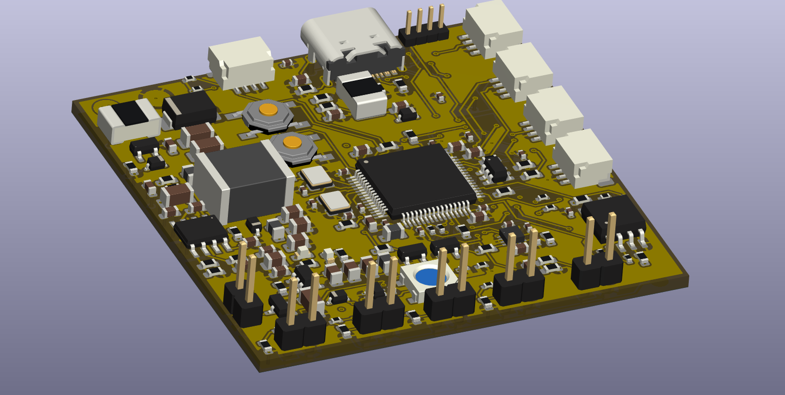
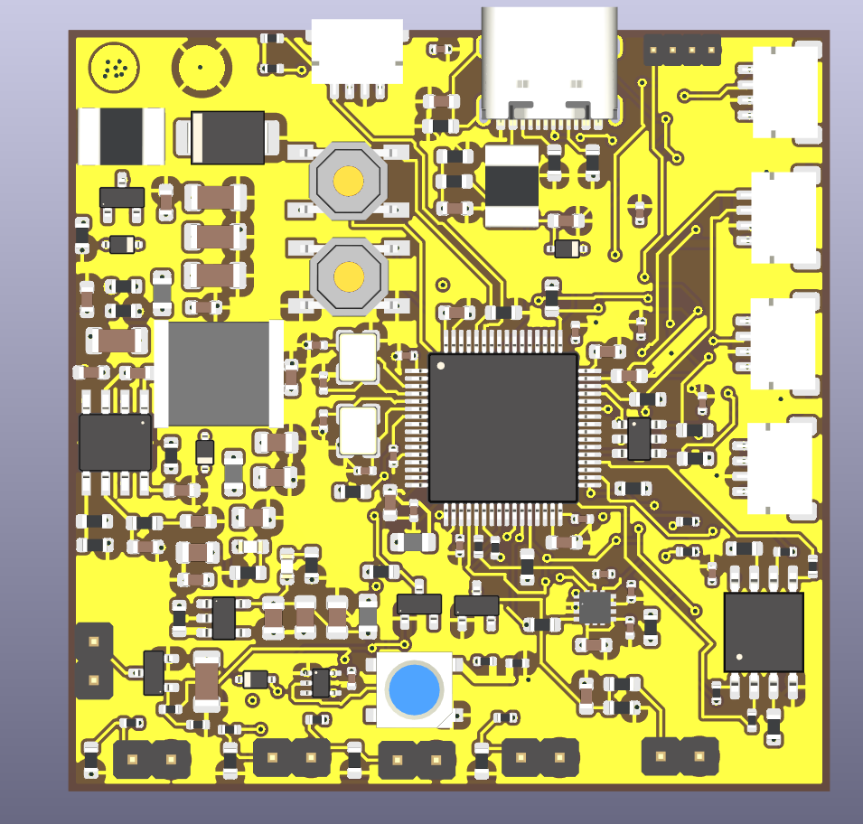
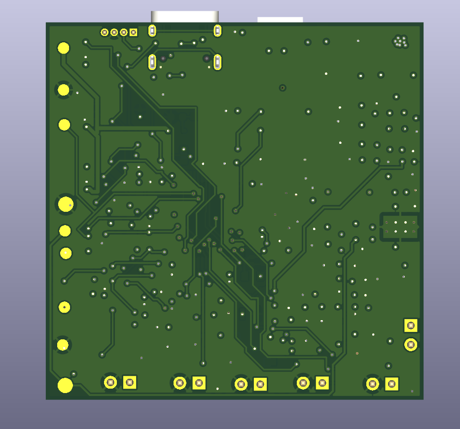
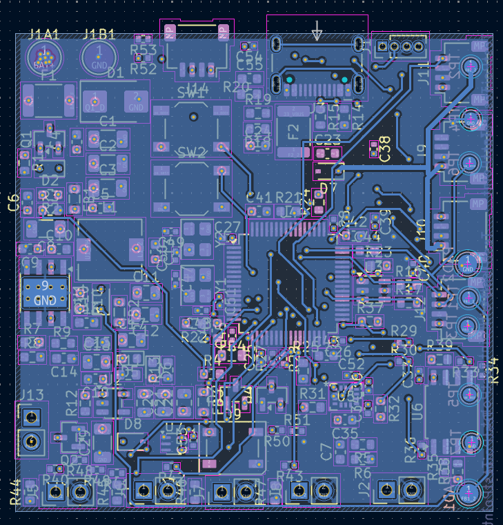
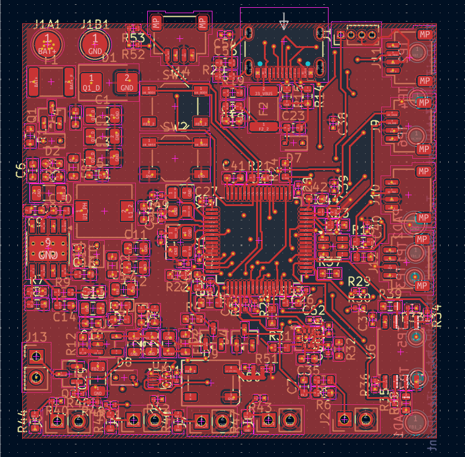

# FLIGHT CONTROLLER - STM32F405

A custom 4 layer flight controller built from scratch for YSWS Pixl. This follows a hybrid approach of 50mm*50mm which is not normal for actual FCs on drone. This is only a **paper-design**. This has not been manufactured yet.

# Overview

This FC contains minimal architecture (as i am a rookie), it does not contain in built barometer or OSD.

# Architecture

'''
Flight_Controller
├── PCB
│   ├── FlightController_Drone.csv
│   ├── FlightController_Drone.kicad_pcb
│   ├── FlightController_Drone.kicad_pro
│   ├── FlightController_Drone.kicad_sch
│   └── gerbers.zip
├── README.md
└── images
    ├── DRAFT
    │   ├── S10_2.png
    │   ├── S11_2.png
    │   ├── S12_2.png
    │   ├── S13_2.png
    │   ├── S1_1.png
    │   ├── S2_1.png
    │   ├── S3_1.png
    │   ├── S4_2.png
    │   ├── S4_P.png
    │   ├── S5_2.png
    │   ├── S6_2.png
    │   ├── S7_2.png
    │   ├── S8_2.png
    │   ├── S9_2.png
    │   └── SFull_2.png
    └── FINAL
        ├── 3D_PCB.png
        ├── 3D_PCB_B.png
        ├── 3D_PCB_HERO.png
        ├── Annotation 2026-10-11 182149.png
        ├── B_CU_PCB.png
        ├── DRC_DUMB.png
        ├── F_CU_PCB.png
        ├── F_PCB.png
        ├── In1_CU.png
        ├── In2_CU.png
        ├── S1.png
        ├── S10.png
        ├── S11.png
        ├── S12.png
        ├── S13.png
        ├── S2.png
        ├── S3.png
        ├── S4.png
        ├── S5.png
        ├── S6.png
        ├── S7.png
        ├── S8.png
        └── S9.png
'''

# BOM
refer the .csv file in this repo under PCB.

# Gallery

**FOR MORE IMAGES PLEASE CHECK images FOLDER**  

# Note

DRC is giving weird errors about footprints touching each other which is fine until pads touch, so I moved them into warnings.

# AI usage
Ai was used only in one or two instances to verify netlist, this makes AI usage less than 5% for this project.

# License

MIT License and you are free to manufacture this board (ik no one will) but in case it dont work, inform me :)